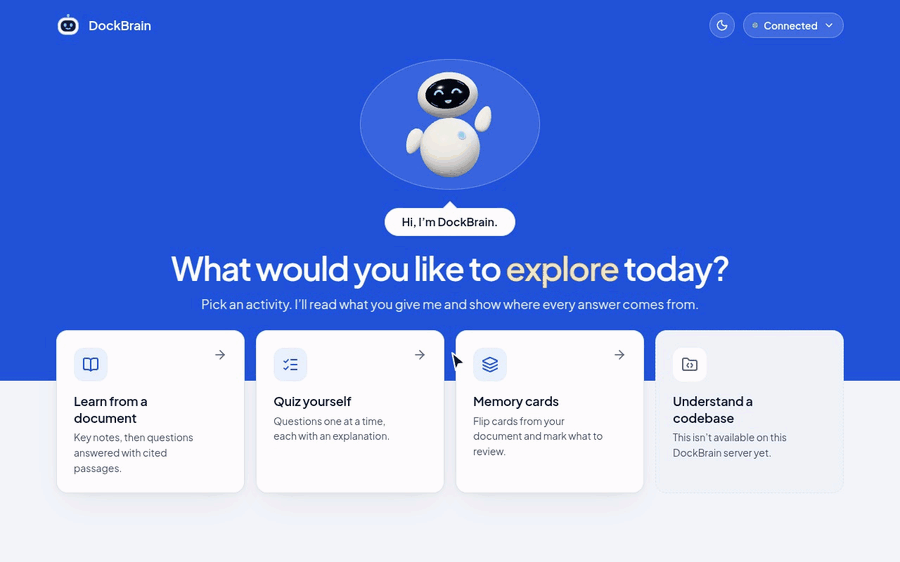
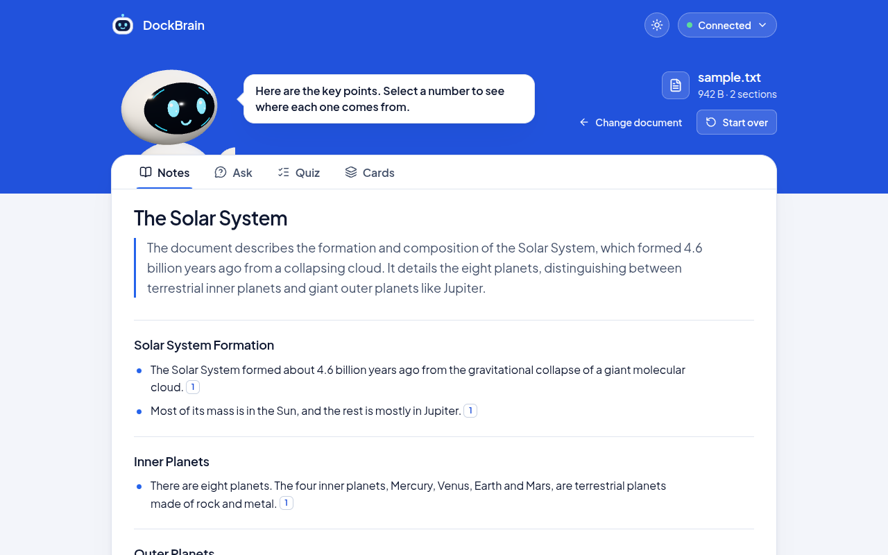
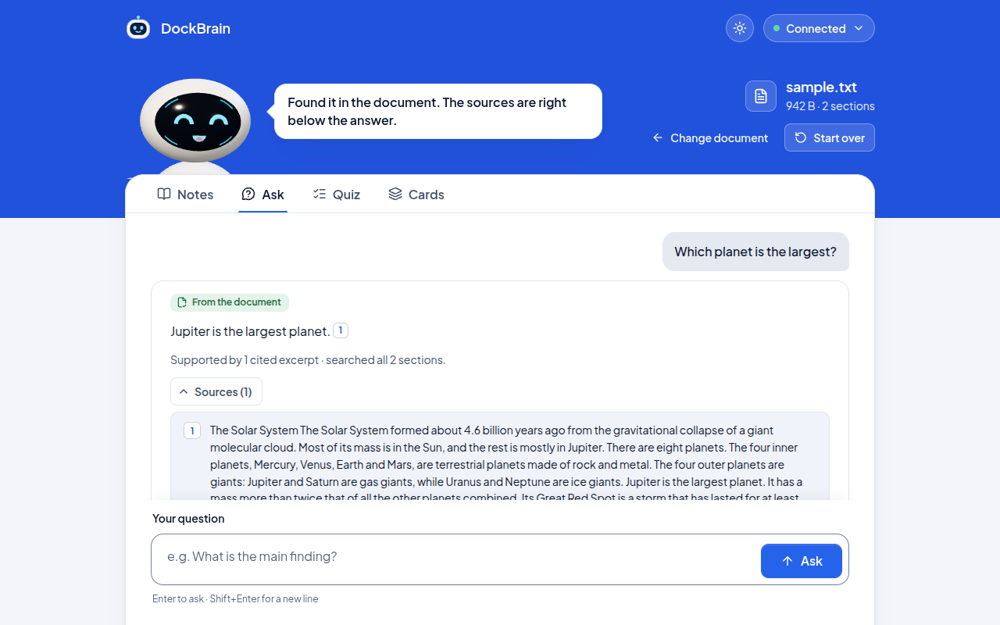
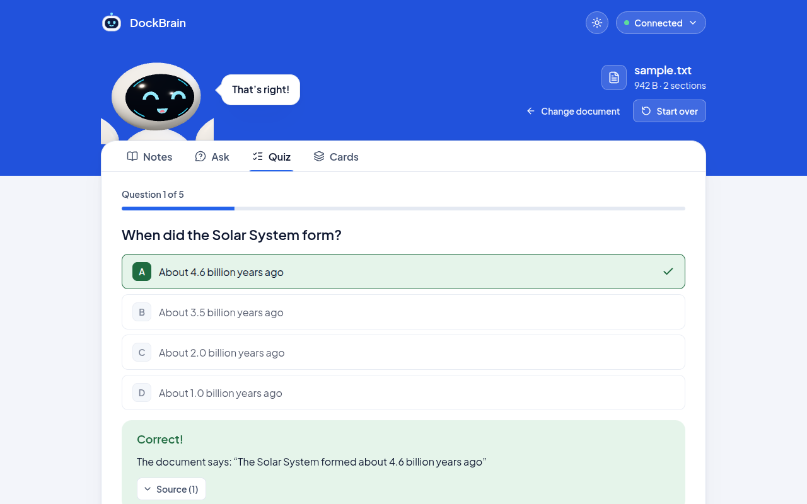
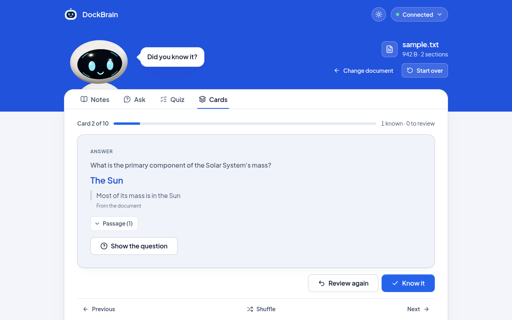

<div align="center">



<br><br>

[](https://github.com/Ayush-Singh0583/DockBrain/actions/workflows/ci.yml)     

### Upload a document and study it.

Read notes, ask questions, take a quiz and flip through memory cards.<br>
Answers show the passages they came from, and say so when they came from somewhere else.

[**Quick start**](#quick-start) &nbsp;·&nbsp; [**What it does**](#what-it-does) &nbsp;·&nbsp; [**How it works**](#how-an-answer-is-made) &nbsp;·&nbsp; [**Privacy and limits**](#privacy-and-limits)

</div>

<br>

<p align="center">
  <picture>
    <source media="(prefers-reduced-motion: reduce)" srcset=".github/readme/demo-still.png">
    
  </picture>
  <br>
  <sub>The real app with a local model, on <a href="sample.txt"><code>sample.txt</code></a>. Time spent waiting for the model is cut out.</sub>
</p>

DockBrain can run on a local AI model through [Ollama](https://ollama.com), so your documents never leave your computer and there are no usage limits.

## What it does

<table>
<tr>
<td width="50%" valign="top">
<picture>
  <source media="(prefers-color-scheme: dark)" srcset=".github/readme/notes-dark.png">
  
</picture>
<h3>Notes</h3>
A summary and key points, each linked to the passage it came from.
</td>
<td width="50%" valign="top">
<picture>
  <source media="(prefers-color-scheme: dark)" srcset=".github/readme/ask-dark.png">
  
</picture>
<h3>Ask</h3>
Ask in your own words. Open the sources to read the passages behind the answer.
</td>
</tr>
<tr>
<td width="50%" valign="top">
<picture>
  <source media="(prefers-color-scheme: dark)" srcset=".github/readme/quiz-dark.png">
  
</picture>
<h3>Quiz</h3>
Multiple-choice questions, one at a time, with an explanation after each.
</td>
<td width="50%" valign="top">
<picture>
  <source media="(prefers-color-scheme: dark)" srcset=".github/readme/cards-dark.png">
  
</picture>
<h3>Memory cards</h3>
One card at a time. Mark each one “Know it” or “Review again”.
</td>
</tr>
</table>

## How an answer is made

<p align="center">
  
</p>

Every answer is labelled, so you can tell what you're reading:

| Label | What it means |
| --- | --- |
| **From the document** | Answered from your document, citing the passages it used. |
| **Partly from the document** | Some of it is cited, and the rest is marked as general knowledge. |
| **General knowledge** | The passages it searched didn't have the answer, so the model answered from what it knows. |
| **Not enough evidence** | It couldn't find an answer, and says so rather than guessing. |

## Quick start

Already set up? Open three terminals in the project folder:

```bash
# Terminal 1: the AI model (skip if Ollama already runs in the background)
ollama serve

# Terminal 2: the backend
.venv/bin/python -m server

# Terminal 3: the web app
cd FRONTEND && npm run dev
```

Then open <http://localhost:5173>. The top bar should say **Connected**.

<details>
<summary><b>First-time setup</b></summary>

#### What you need

| Tool | Version | Used for |
| --- | --- | --- |
| Python | Developed and tested on 3.14 | The backend |
| Node.js | 22.22+ or 24.15+ | The web app |
| Ollama | Tested on 0.40 | The local AI model |
| Disk space | About 9 GB | Ollama and the model |
| Graphics card | 8 GB recommended | Runs the model at a usable speed |

These instructions were tested on Linux. On macOS the commands should be the same. On Windows, use `.venv\Scripts\python` in place of `.venv/bin/python`.

#### 1. Get the code

```bash
git clone https://github.com/Ayush-Singh0583/DockBrain.git
cd DockBrain
```

#### 2. Set up Python

```bash
python3 -m venv .venv
.venv/bin/pip install -r requirements.txt
```

On Debian or Ubuntu, if `venv` is missing, run `sudo apt install python3-venv` first.

#### 3. Set up the web app

```bash
cd FRONTEND
npm install
cd ..
```

#### 4. Install Ollama and the model

**Linux, with admin rights.** This also starts Ollama in the background on every boot:

```bash
curl -fsSL https://ollama.com/install.sh | sh
```

**Linux, without admin rights.** This installs into your home folder, and you start Ollama yourself with `ollama serve`. `~/.local/bin` must be on your `PATH`.

```bash
mkdir -p ~/.local/ollama ~/.local/bin
curl -fL -o /tmp/ollama.tar.zst https://ollama.com/download/ollama-linux-amd64.tar.zst
tar --zstd -xf /tmp/ollama.tar.zst -C ~/.local/ollama
rm /tmp/ollama.tar.zst
ln -sf ~/.local/ollama/bin/ollama ~/.local/bin/ollama
```

**macOS or Windows.** Download it from <https://ollama.com/download>.

Then download the model (6.6 GB). Ollama must be running for this, so start `ollama serve` in another terminal if needed.

```bash
ollama pull qwen3.5:9b
```

#### 5. Connect everything

Run these from the project folder:

```bash
echo 'OLLAMA_MODEL=qwen3.5:9b' >> .env
echo 'VITE_DOCKBRAIN_API_URL=http://127.0.0.1:8000/api/v1' > FRONTEND/.env.local
```

The first line tells the backend which model to use. The second tells the web app where the backend is. Both files are ignored by git.

Setup is done. Start the app with the [Quick start](#quick-start) commands.

</details>

## Using the app

Pick an activity on the welcome screen, then choose a file. PDF, Word (`.docx`), text and Markdown files up to 50 MB work.

| Activity | What it does |
| --- | --- |
| **Learn from a document** | Notes with a summary and key points, plus an Ask tab for your own questions. |
| **Quiz yourself** | Multiple-choice questions, with an explanation after each. |
| **Memory cards** | One card at a time. Mark each one "Know it" or "Review again". |
| **Understand a codebase** | Sample content only for now. It's turned off when the backend is connected. |

Once a document is open, you can switch between Notes, Ask, Quiz and Cards using the tabs.

Memory card keys: **Space** flips the card, **←** and **→** move between cards, and after flipping, **K** marks "Know it" and **R** marks "Review again".

The first result for a document usually takes 15 to 45 seconds while the model writes it. Those timings are from an 8 GB RTX 5060. A slower machine will take longer.

## Reference

<details>
<summary><b>Choosing how it answers</b></summary>

DockBrain uses the first of these it finds set up:

| Order | Mode | How to turn it on | Where your text goes |
| --- | --- | --- | --- |
| 1 | **Ollama** (recommended) | `OLLAMA_MODEL=qwen3.5:9b` in `.env` | Stays on your computer |
| 2 | **Gemini** (free tier) | `GEMINI_API_KEY=...` in `.env`, with no `OLLAMA_MODEL` | Passages go to Google |
| 3 | **Claude** | `ANTHROPIC_API_KEY=...` in `.env`, with neither of the above | Passages go to Anthropic |
| 4 | **No model** | Set up none of the above, or start with `--offline` | Stays on your computer |

- Without a model, notes, cards and quizzes are cut straight from the document's sentences, so they're much weaker. A model is strongly recommended.
- You can create a free Gemini key at <https://aistudio.google.com/apikey>. In testing, `gemini-3.6-flash` allowed 20 requests a day.
- Claude hasn't been tested against the live service.
- If a model fails, notes, cards and quizzes fall back to the no-model versions and show a notice explaining why.

To try a smaller model, such as `qwen3.5:4b` (3.3 GB, not tested with DockBrain), run `ollama pull` for it, change `OLLAMA_MODEL`, and restart the backend.

</details>

<details>
<summary><b>Using the command line</b></summary>

You can ask questions about a document without the web app:

```bash
.venv/bin/python main.py path/to/document.pdf
```

| Option | Effect |
| --- | --- |
| `--offline` | Use no AI model. |
| `--show-sources` | Print the passages used for each answer. |
| `--top-k N` | Choose how many passages to look at. |

Press Enter on an empty line, or type `exit`, to quit.

</details>

<details>
<summary><b>Settings</b></summary>

**Backend settings** go in `.env` in the project folder. A value set in the terminal wins over the file.

| Setting | Default | Meaning |
| --- | --- | --- |
| `OLLAMA_MODEL` | Not set | The local model to use. |
| `GEMINI_API_KEY` | Not set | Your Gemini key. |
| `GEMINI_MODEL` | `gemini-3.6-flash` | Which Gemini model to use. |
| `ANTHROPIC_API_KEY` or `ANTHROPIC_AUTH_TOKEN` | Not set | Your Claude credentials. |
| `DOCKBRAIN_SESSION_TTL` | `1800` | Seconds before an unused document is deleted. |
| `DOCKBRAIN_CORS_ORIGINS` | The Vite ports on this computer | Comma-separated web addresses allowed to call the backend. |

**Web app settings** go in `FRONTEND/.env.local`. Restart `npm run dev` after changing them.

| Setting | Meaning |
| --- | --- |
| `VITE_DOCKBRAIN_API_URL` | The backend's address. Leave it empty for demo mode. |
| `VITE_ROBOT_GLB_URL` | Another 3D robot model, or `none` for a simple built-in one. |

Never put API keys in `FRONTEND/.env.local`. Everything in that file is visible in the browser.

**Backend options:** `.venv/bin/python -m server [--host 127.0.0.1] [--port 8000] [--offline]`

If you change the port, update `VITE_DOCKBRAIN_API_URL` to match.

</details>

<details>
<summary><b>Troubleshooting</b></summary>

| What you see | What to do |
| --- | --- |
| The top bar says **Demo mode** | `FRONTEND/.env.local` is missing or wrong. Fix it, then restart `npm run dev`. |
| Cards and quizzes are fill-in-the-blank sentences | The backend isn't using a model. Restart it without `--offline`. |
| "Ollama isn't running" | Run `ollama serve`. |
| "Ollama doesn't have the model" | Run `ollama pull qwen3.5:9b`, or fix `OLLAMA_MODEL` in `.env`. |
| `ollama serve` says the address is already in use | Ollama is already running, so you can carry on. |
| Port 8000 is already in use | Another backend is running. Stop it with Ctrl+C in its terminal, or start this one with `--port`. |
| "Connected" but nothing loads | Check the backend's terminal for errors, and that it's still running. |
| Answers are very slow | Run `ollama ps`. If `PROCESSOR` doesn't say `100% GPU`, the model doesn't fit on your graphics card, so try a smaller one. |
| A PDF has no readable text | Scanned pages aren't supported yet. Use a PDF with selectable text. |

</details>

<details>
<summary><b>Tests and checks</b></summary>

None of these call a real AI model.

```bash
# Backend
.venv/bin/python -B -m unittest discover -s tests

# Web app
cd FRONTEND
npm run typecheck
npm test
npm run build
```

GitHub runs the same checks on every push to `main` and every pull request (`.github/workflows/ci.yml`), with and without the optional Python packages. Python packages are pinned to exact versions in `requirements.txt`, and web packages in `FRONTEND/package-lock.json`.

To measure how often the checks on model-written notes, cards and quiz questions are wrong, see [`evals/claims/README.md`](evals/claims/README.md).

To see what a model writes for a document, with Ollama running:

```bash
.venv/bin/python -B evals/try_model.py qwen3.5:9b sample.txt
```

Add `--counts-only` for private documents, so none of their text is printed.

</details>

<details>
<summary><b>Project layout</b></summary>

```text
main.py          Command-line program, and the choice of AI model
rag/             Reading documents, search, answers, notes, memory cards and quizzes
server/          The HTTP API used by the web app
tests/           Backend tests
evals/           Scripts for measuring answer quality
FRONTEND/        The React web app
GLB/             The 3D robot models
sample.txt       A short document to try
```

More detail:

- [`FRONTEND/README.md`](FRONTEND/README.md): the web app, the robot and its URL switches
- [`FRONTEND/API_CONTRACT.md`](FRONTEND/API_CONTRACT.md): the HTTP API

</details>

## Privacy and limits

- With Ollama or `--offline`, nothing leaves your computer. With Gemini or Claude, passages from your document are sent to that company.
- An uploaded file is deleted as soon as it has been read. The text kept for searching is deleted when you start over, or after 30 idle minutes.
- The server's logs don't contain file names, document text, questions or answers.
- The backend has no login, so keep it on `127.0.0.1` and don't expose it to a network.
- Scanned pages and images aren't read, and tables lose their layout.
- Each card, quiz question and note point must come with a quote found in your document and share words with it. That doesn't prove the quote supports it: a claim that reverses its quote can still pass, and some items are trivial or filed under the wrong heading. When something matters, read the quote or passage shown with it. [`evals/claims/README.md`](evals/claims/README.md) measures how often this goes wrong.
- Notes read at most 40 passages, so long documents are sampled.
- "Know it" and "Review again" marks aren't saved after you close the page.
# DockBrain
